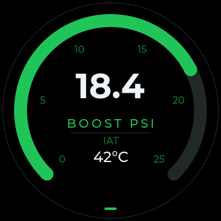
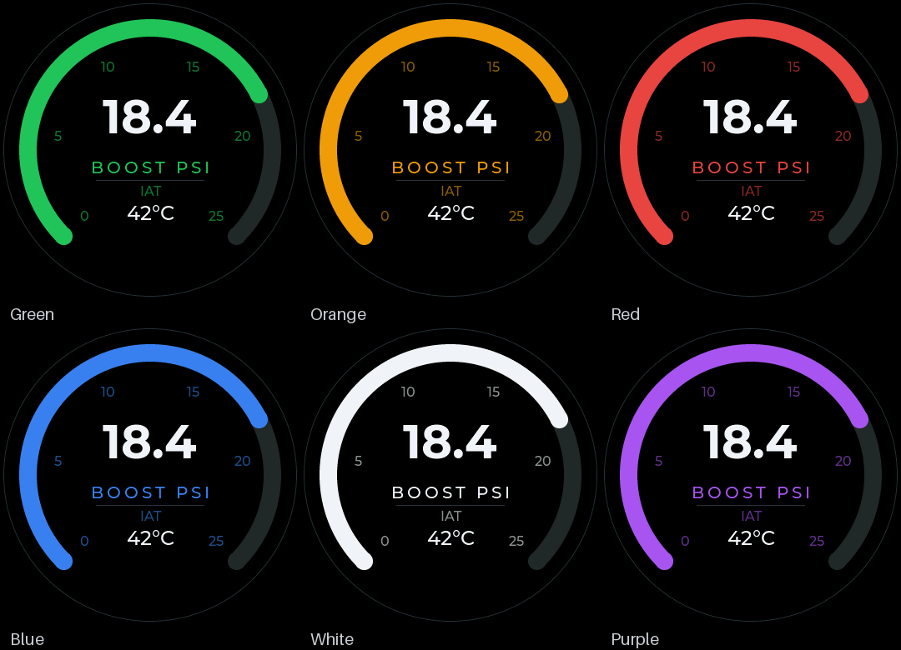

# ESP32-S3-Gauge

A standalone **digital boost gauge** for the
**[OpenHaldex](https://github.com/Forbes-Automotive/OpenHaldex-C6)** Haldex
controller, running on a **Waveshare ESP32-S3-Touch-AMOLED-1.75** (466x466
round AMOLED, CO5300 over QSPI, CST9217 touch).

The gauge **listens** to the car: it reads the controller's `OHX_STATUS`
ESP-NOW broadcast for boost (and rpm/speed/throttle/mode/lock), and decodes
intake air temperature from `Engine_3` (`0x380`) in the CANN relay. It never
touches the car's CAN bus and the controller firmware is not modified.

It **transmits one thing**: a signed Haldex mode request, sent when the driver
taps the **Haldex screen**. That is the whole control surface — one gesture, on
one screen, and the controller's own answer is what the screen shows. There is
no CAN transmit, no automatic action and no other ESP-NOW traffic; the other RF
it originates is its own **CANv-gauge** setup AP, which serves a settings page
and OTA uploads.

It also has a local **G-meter** screen driven by the board's QMI8658 IMU:
acceleration/braking on the vertical axis, a fading 1 s tail, and a white
1 s average readout. The IMU is on the gauge's own I2C bus, so the G-meter
does not touch the car's network.

> This repository is AI-generated and human-tested on one board. It is not
> security-audited. Read the code before you flash it.



## What it shows

- Edge-to-edge 270-degree arc with six evenly spaced scale labels, one
  consistent accent colour across the whole sweep (no warning colours). The
  default scale is `0 / 5 / 10 / 15 / 20 / 25` PSI; both ends are editable
  from the web page (0.1 PSI steps, minimum may be negative for vacuum).
- Large 96 px boost value with the decimal point on the text baseline.
- `BOOST PSI` caption, and the intake air temperature under a thin rule.
- Automatic day/night dimming from the car's Terminal 58s dash-dimmer
  reading (`Cluster_2`, `0x420`) in the CANN relay, using the same curve as
  `OpenHaldex-S3-Dash`. Terminal 58d is not used: it reads non-zero with the
  lights off. Without a 58s reading the emission stays at the day level.
- **Seven colour schemes**, copied from `OpenHaldex-S3-Dash` so the gauge and
  the dashboard on the same car read the same: **Midnight, Orange, Green,
  Blue, Purple, White, Red**. Midnight is the default. A **550 ms hold** on the
  glass steps to the next one, as does a **short press** of the board's
  **BOOT** key (GPIO0); a **700 ms hold** of the key switches screens. The key
  is polled with a 30 ms debounce, so a deliberate tap lands even while the arc
  is repainting. With the CANN relay on, **Cancel + Down** together on the PQ
  cruise stalk cycles the accent, and a **long press of Down alone** switches
  screens (`[ui] cruise mode`); each accent source logs `[ui] accent <name>`
  (the stalk adds `[ui] cruise combo`). The scheme is stored in NVS and
  survives a power cycle.
- A **horizontal swipe** slides to the next screen. The swipe animates with a
  280 ms cubic ease-out push, because that is the motion the finger just made;
  BOOT, the stalk and the web page keep the 260 ms cross-fade.
- A **Haldex screen**: the mode in force (`STOCK`, `FWD`, `50:50`, `60:40`,
  `75:25`, `EXPERT`), the lock the controller is requesting and the lock the
  coupling is actually giving, with the coupling state underneath. **One
  tap** asks the controller for the next mode — see [Haldex
  screen](#haldex-screen).
- A **G-meter screen**: a 65 px accent-coloured blob moves vertically for
  acceleration/braking and horizontally for lateral acceleration; a fading
  tail covers the last second. The white `0.00 g` readout at the bottom is
  the 1 s average of the two-axis magnitude. See
  [G-meter mode](#g-meter-mode).
- A **26x5 px link line** at the bottom edge: green when `OHX_STATUS` is
  fresh, orange when it is stale, amber when only CANN is arriving, red when
  nothing has been heard.
- Unknown values draw `--`, never a fake zero. A genuine `0` draws `0`.



## Hardware

| Piece | Notes |
|---|---|
| Display board | Waveshare ESP32-S3-Touch-AMOLED-1.75, ESP32-S3R8, 16 MB flash, 8 MB OPI PSRAM |
| Panel | 466x466 CO5300 AMOLED, QSPI, visible area starts at controller column 6 |
| Panel reset | GPIO39 |
| Brightness | emission register `0x51` (an AMOLED has no backlight) |
| Touch | CST9217 at I2C `0x5A`, reset GPIO40, interrupt GPIO11 (not used: polled) |
| IMU | QMI8658 6-axis at I2C `0x6B` on the same bus, ±4 g / 250 Hz |
| BOOT key | GPIO0, active low, internal pull-up |
| Power button | battery latch, not a GPIO input (see below) |
| Bench listener | Plain ESP32-WROOM devkit (`env:esp32dev`) |

The TCA9554 expander, AXP2101 PMIC and PCF85063 RTC share that I2C bus
(SDA 15 / SCL 14). The expander is left at its power-on default — every pin an
input — because all of its pins belong to other chips; nothing here drives it.

### Board history

The firmware was developed on a **Waveshare ESP32-S3-LCD-1.85** (360x360
ST77916). That unit's panel failed, and 0.6.0 moved the build to the AMOLED
board. The 1.85 pin map, the TCA9554 LCD reset and the 72 px value face are
in git history, not in this tree. What the move involved, and which
assumptions had to be corrected on the bench, is recorded in
[`docs/board-port-amoled-175.md`](docs/board-port-amoled-175.md).

## G-meter mode

The QMI8658 is on the control I2C bus, so the G-meter is entirely local. The
screen is a 65 px blob in the active accent colour, centred at 0 g. Its
vertical position is acceleration/braking; its horizontal position is lateral
acceleration. A 20-dot tail fades over the last second; the readout at the
bottom is the 1 s mean of `sqrt(longitudinal² + lateral²)`.

Switch screens from the web page, the console `m` key, a **700 ms BOOT
hold**, a **horizontal swipe**, or a **long Down press on the PQ cruise stalk**
(CANN relay on). The mode is stored in NVS. The board's power button is a
battery latch, not a GPIO input, so BOOT is the only physical key; a short
press still steps the colour scheme. A key or web change is a 260 ms
cross-fade, a swipe is a 280 ms slide. Each object fades its own opacity
because a full-screen LVGL opacity layer would need 434 KB and the pool is
128 KB.

The math follows the usual accelerometer G-meter practice:

- **Gravity is learned, not assumed zero.** A 2 s tracker follows the gravity
  vector while the car is stationary. A fresh controller speed below 1 km/h
  is trusted on its own, so engine vibration does not freeze the zero; with
  no speed data the IMU gate is `| |a| - 1 g | < 0.06 g` and gyro under
  0.2 rad/s. A tilt changes which axis gravity is on but not `|a|`, so a new
  mount attitude is re-learned instead of leaving a permanent offset.
- **Dynamic acceleration is low-passed at 8 Hz.** This rejects road vibration
  without eating a launch.
- **The magnitude is `sqrt(v² + l²)`, not `(|v| + |l|) / 2`.** The latter
  understates a diagonal 1 g vector by about 29%. The instantaneous magnitude
  is averaged over 1 s, matching "how hard was that pull/corner" rather than
  "what is the vibration now".
- **A 0.01 g deadband** keeps the blob still at idle.
- **Zero is explicit.** The web page's **Zero G-meter** button stores the
  current attitude as 0 g. Press it with the car stationary. With no IMU
  sample at all, Zero does nothing and the display stays `--`.

Mount and direction are stored settings:

| Mount | Longitudinal axis | Lateral axis | Typical install |
|---|---|---|---|
| **Upright** (default) | chip Z (screen normal) | chip X | Gauge faces the driver |
| **Flat** | chip Y (screen vertical) | chip X | Screen up, top of the glass forward |
| **Auto** | from gravity | chip X | Picks upright or flat at boot |

`Auto` compares the learned gravity on chip Y and Z: upright puts it on Y,
flat on Z. A 45 degree mount is ambiguous; use the explicit setting there.

**Flip accel/brake** inverts the longitudinal sign for a 180° mount. The
default signs assume the QMI8658 is on the back of the PCB, with +Z pointing
away from the glass. Check the first drive: the blob must move up under
acceleration and down under braking; if it is reversed, tick Flip. Accuracy in
a car has not been verified yet (see [`docs/status.md`](docs/status.md)).

The panel's **TE output** is used for the moving dot: `display.cpp` waits
for the CO5300 V-blank edge before flushing a render, so the dot is not
written while the panel scans the same rows. The boot log states whether
the signal was found (`[lcd] TE sync on ...`); if it says `TE not pulsing`,
the flush falls back to unsynced. The panel IO queue holds 64 transfers,
and the G-meter draws its dot, tail and readout into one 466x388 canvas, so
only one object is invalidated instead of a blob, 20 tail dots and a label.
The display uses one partial draw buffer and serialises the flushes.

## Haldex screen

The Haldex screen (the console calls it `haldex`) is four lines of type:
`HALDEX`, the **mode in force**, `LOCK REQ` and `LOCK ACT` percentages, and a
line under the mode for the coupling state. It replaced a drivetrain drawing
that could not be read on the glass in a car.

**One tap asks the controller for the next mode**, in the controller's own
order: `STOCK → FWD → 50:50 → 60:40 → 75:25 → EXPERT → STOCK`. A standalone
controller has no `STOCK` to fall back on, so that step is skipped. The
sub-line shows what happened: `60:40: sending` in amber, then `60:40: ok` in
green when the controller's own mode byte becomes the mode asked for. If the
controller is broadcasting but its flag does not move, the line reads
`60:40: NO CHANGE` for five seconds; if nothing is being broadcast, it reads
`NO CONNECTION`. One request is in flight at a time: the controller's nonce
is single-use, so a second tap waits for the next status packet rather than
signing against a spent nonce. There is no automatic retry.

This is the only thing the gauge transmits. The request is `OHX_C_MODE` over
ESP-NOW, unicast to the controller that is broadcasting `OHX_STATUS`, signed
with HMAC-SHA256 keyed on **that controller's AP password** — which is why
there is a password field on the web page. An open AP means an empty key,
which is still a key. The controller never replies directly: the verdict is
the `mode` byte in its next status broadcast, which is what the sub-line
reads. The `ackSrc`/`ackSeq`/`ackResult` echo is not read — in use it
disagreed with the flag, and the flag is the thing on the glass.

If the controller's AP is passworded and no key is stored, a tap sends nothing;
the glass reads `NO CHANGE` and the console says `controller needs a key, none
stored`. A wrong key looks the same on the glass, by design: the mode does not
move, and the console line is the diagnosis.

> **The open-AP case.** With no AP password the key is the empty string and the
> nonce is broadcast, so anyone in range can compute a valid signature. That is
> how the protocol was designed; if that matters, put a password on the
> controller's AP and enter it on the gauge's page.

## Boot screen

Every boot shows [`assets/canvas-gauge-splash-466-base.jpg`](assets/canvas-gauge-splash-466-base.jpg)
for three seconds. The JPEG is linked into flash and decoded by the S3 mask
ROM's TJpgDec into a temporary 434,312 B PSRAM buffer (147 ms measured); the
buffer is freed when the splash is deleted, not hidden. A green `lv_bar`
sits on the artwork's rule (258x4 at x=104, y=262) and fills from 0 to
100% over 3 s; the running version is bottom right. The panel's emission is
held at zero until the first splash frame is queued, so boot noise is not
shown.

The splash can be photographed with `-DGAUGE_CAPTURE_SPLASH=1`; see
[Capturing the glass](#capturing-the-glass).

## Build and flash

```bash
python3 -m venv .venv
./.venv/bin/pip install platformio pyserial

# Display board, native USB CDC on /dev/ttyACM0
./.venv/bin/pio run -e esp32s3
./.venv/bin/pio run -e esp32s3 -t upload --upload-port /dev/ttyACM0

# Headless WROOM CANN listener, CH340 on /dev/ttyUSB0
./.venv/bin/pio run -e esp32dev
./.venv/bin/pio run -e esp32dev -t upload --upload-port /dev/ttyUSB0
```

Build sizes for the current version are recorded in
[`docs/status.md`](docs/status.md).

## Monitor

```bash
./.venv/bin/python tools/monitor.py /dev/ttyACM0
```

Console keys while it is running:

- `i` — raw/packet/frame/reject counters and the current channel
- `s` or `r` — force a channel scan
- `b` — step the colour scheme (same action as a short BOOT press)
- `m` — boost gauge <-> G-meter (same action as a 700 ms BOOT hold)
- `z` — zero the G-meter (car stationary)
- `g` — print the current G reading once
- `t` — toggle a 5 Hz log of the mapped touch point, for checking the mirror
  and axis flags in `board_config.h`
- `a` — toggle a 2 Hz raw accelerometer/gyro dump, for checking the mount axes

A healthy link looks like:

```text
ESP32-S3-Gauge 0.6.0
[gauge] boost from OHX_STATUS, IAT from Engine_3 (0x380)
[set] scheme 0, scale 0.0..25.0 PSI
[set] mode gauge, mount upright, flip 0
[lcd] bringing up the 1.75" CO5300 AMOLED
[lcd] CO5300 init (466x466, gap 6, 80 MHz QSPI)
[lcd] TE sync on (4 edges, high 916 low 20604, rising edge)
[lcd] Waveshare ESP32-S3-Touch-AMOLED-1.75 ready (466x466)
[imu] QMI8658 at 0x6B, accel +/-4 g 250 Hz, gyro 256 dps
[touch] CST9217 at 0x5A, 466x466, tap = scheme, swipe = screen
[ui] mode gauge, mount upright, flip 0
[splash] picture 466x466 in 147 ms (14414 B flash, 434312 B PSRAM)
[ui] splash up (3 s)
[ui] accent Midnight (BOOT: short = scheme, long = screen; touch: tap = scheme, swipe = screen)
[ui] splash down
[now] scan: 7 APs; anchor "CANv-dash" ch 2 (-48 dBm)
[now] hop limit is now 1-11
[web] AP "CANv-gauge" (open) channel 1, http://192.168.4.1/
[now] setup AP up: holding channel 1 (scan-only discovery)
[now] listening on channel 1
[can] IAT 4.5 C
[gauge] ch=1 OHX=9.8/s boost=ok IAT=ok cann=184 rssi=-74
```

The receiver starts on the family fallback channel 1, scans for the
`OpenHaldex-C6` AP first and the dash AP second (`CANv-dash`, or the older
`ohx-dash`), and hops through 1..13 only
while it has been quiet. With the setup AP up it holds one channel instead
(see below) and relies on the 15 s scan, because AP+STA share a single radio
and a softAP that moves every 400 ms is not joinable.

## Web page, settings and OTA

The gauge always runs its own AP:

| | |
|---|---|
| SSID | `CANv-gauge` |
| Address | <http://192.168.4.1/> |
| Network | open (no password) by default |

Join it from a phone or laptop. The page shows live boost, IAT, the G
average and its two signed axes, channel, RSSI and packet rate. These controls
persist in NVS:

- **Colour scheme** — the same seven as the BOOT key and a tap.
- **Scale** — minimum and maximum in 0.1 PSI steps, limited to -15.0..50.0
  PSI with a span of 5..60 PSI. The arc re-labels and re-ranges immediately.
  The numeric readout still shows a value outside the scale; only the arc
  clamps. A negative minimum is allowed because the controller reports
  vacuum as a negative mbar value.
- **Display** — choose **Boost gauge** or **G-meter**, the mount
  (**Upright**, **Flat** or **Auto**), and **Flip accel/brake**. **Zero
  G-meter** stores the current attitude as 0 g; use it stationary.

Firmware upload uses the same page or curl:

```bash
./.venv/bin/pio run -e esp32s3
curl -F "firmware=@.pio/build/esp32s3/firmware.bin" http://192.168.4.1/update
```

The image is written to the inactive OTA slot, so a failed upload cannot
overwrite the running one, and the gauge reboots into it. A 1.39 MB image took
about 7 s on the bench.

### The AP shares the radio

ESP32 AP+STA uses one radio, so the AP has no channel of its own:

- it starts on the channel the receiver is on;
- while the AP is up the channel walk is disabled, so the AP stays joinable;
  the periodic full scan still finds the controller's AP;
- a connected page client freezes all channel changes, so the page is not
  dropped mid-edit.

The trade-off: an anchor whose SSID is hidden cannot be found while the AP is
up, because discovery is by name. See [`TODO.md`](TODO.md).

### Security

The AP is **open** and the page can flash firmware, so anyone within WiFi
range can change the settings or upload an image. To require WPA2, add a
build flag:

```ini
build_flags = -DGAUGE_AP_PASSWORD=\"your-password\"
```

The boot log states which mode is active:
`[web] AP "CANv-gauge" (open) channel 1, http://192.168.4.1/`.

Two credentials are involved and neither belongs in git: the gauge's own AP
password (a build flag, above) and the controller's AP password (entered on the
page, stored in NVS, only ever used to sign a mode request). The console says
whether the latter is stored, never what it is.

## Capturing the glass

Layout and colour changes can be checked without a camera. The capture build
renders one frame per scheme and streams each 466x466 RGB565 framebuffer over
USB:

```bash
PLATFORMIO_BUILD_FLAGS="-DGAUGE_CAPTURE=1" \
  ./.venv/bin/pio run -e esp32s3 -t upload --upload-port /dev/ttyACM0
./.venv/bin/python tools/capture_frame.py /dev/ttyACM0 /tmp/gauge
```

This writes `gauge_<n>_<scheme>.ppm`, seven of them. The capture code and its
1 MB LVGL pool are compiled out of normal firmware. To photograph another
reading (for example a vacuum value with a negative minimum), override the
fixed boost:

```bash
PLATFORMIO_BUILD_FLAGS="-DGAUGE_CAPTURE=1 -DGAUGE_CAPTURE_BOOST=-2.5f" \
  ./.venv/bin/pio run -e esp32s3 -t upload --upload-port /dev/ttyACM0
```

The capture sweep does not write settings to NVS. To capture the G-meter
layout instead, add `-DGAUGE_CAPTURE_GMETER=1`. It feeds a synthetic 0.5 Hz
sweep so the blob, tail and bottom readout all appear:

```bash
PLATFORMIO_BUILD_FLAGS="-DGAUGE_CAPTURE=1 -DGAUGE_CAPTURE_GMETER=1" \
  ./.venv/bin/pio run -e esp32s3 -t upload --upload-port /dev/ttyACM0
./.venv/bin/python tools/capture_frame.py /dev/ttyACM0 /tmp/gmeter
```

That writes one frame named by scheme, exactly like the gauge sweep.

`-DGAUGE_CAPTURE_DRIVE=1` captures the Haldex screen with a fixed `60:40`
mode and a 45% request against a 38% actual, one frame per scheme:

```bash
PLATFORMIO_BUILD_FLAGS="-DGAUGE_CAPTURE=1 -DGAUGE_CAPTURE_DRIVE=1" \
  ./.venv/bin/pio run -e esp32s3 -t upload --upload-port /dev/ttyACM0
./.venv/bin/python tools/capture_frame.py /dev/ttyACM0 /tmp/haldex
```

A capture build cannot send a mode request: only a tap transmits, and a
capture is a render.

`-DGAUGE_CAPTURE_SPLASH=1` captures the boot screen instead, at two seconds
with the loading rule part-filled:

```bash
PLATFORMIO_BUILD_FLAGS="-DGAUGE_CAPTURE=1 -DGAUGE_CAPTURE_SPLASH=1" \
  ./.venv/bin/pio run -e esp32s3 -t upload --upload-port /dev/ttyACM0
./.venv/bin/python tools/capture_frame.py /dev/ttyACM0 /tmp/splash 1
```

Host-only checks (no hardware) live in `tools/`:

```bash
g++ -std=c++17 -Isrc -Iinclude -o /tmp/gmeter_test tools/gmeter_test.cpp src/app/gmeter.cpp -lm
/tmp/gmeter_test

g++ -std=c++17 -Itools/host -Isrc -Iinclude -o /tmp/boot_button_test tools/boot_button_test.cpp src/hal/boot_button.cpp
/tmp/boot_button_test

g++ -std=c++17 -Isrc -Iinclude -o /tmp/gesture_test tools/gesture_test.cpp src/hal/gesture.cpp
/tmp/gesture_test
```

`gmeter_test` checks gravity removal, the 0.5 g signs, the diagonal
`sqrt(v² + l²)`, the speed gate, tilt re-learning, auto mount and Zero. `boot_button_test`
checks short, long and bounce behaviour. `gesture_test` drives the touch
classifier at the 15 ms poll rate: a still press is a tap, an 8 px jitter is
still a tap, a 550 ms dwell is a hold that fires while the finger is down and
whose release is swallowed, a 60 px drag is a swipe, and a flick that wanders
past 12 px — including one that comes back to where it started — is nothing at
all. None of them touches the panel, the IMU or the car.

## Repository layout

```text
include/     board pins, LVGL config, theme, version, shared wire headers
src/app/     config, NVS settings (scheme/scale/mode/mount/key), G-meter math
src/hal/     CO5300 QSPI panel, CST9217 touch + gestures, BOOT key, QMI8658 IMU
src/net/     ESP-NOW receive, mode request, channel discovery, IAT decode, page
src/ui/      gauge, oil/coolant faces, Haldex face, G-meter, transitions, splash
tools/       serial monitor, framebuffer capture, host math/button checks
assets/      splash art and documentation screenshots
docs/        status and verification notes
AGENTS.md    guidance for AI coding agents
TODO.md      open hardware and firmware items
```

## Verification and status

- [`docs/status.md`](docs/status.md) — what was measured on the bench, what is
  still unverified, and the current build size.
- [`TODO.md`](TODO.md) — open items, including the first in-car G-meter test
  and the physical BOOT long-press check.
- [`docs/board-port-amoled-175.md`](docs/board-port-amoled-175.md) — the
  AMOLED move: pin map, the assumptions that had to be corrected, and what
  still needs a human.
- [`AGENTS.md`](AGENTS.md) — conventions, hard rules and where to change what.

## Credits

The controller, its CAN decoding and the ESP-NOW protocol are the work of
**[Forbes Automotive](https://github.com/Forbes-Automotive/OpenHaldex-C6)**.
`include/ohx_proto.h` and `include/cannow_proto.h` are verbatim copies of the
shared wire-format headers; refresh them from upstream, never hand-edit them.

The 96 px Montserrat Bold subset is generated from the face used by
[`OpenHaldex-S3-Dash`](https://github.com/adruss85/OpenHaldex-S3-Dash), and
the seven colour schemes are copied from that dashboard's palette table.
The CO5300 panel driver is trimmed from Espressif's
[`esp-iot-solution`](https://github.com/espressif/esp-iot-solution) driver,
with Waveshare's own register sequence for this glass.

## Licence

GPL-3.0-or-later. See [`LICENSE`](LICENSE).
